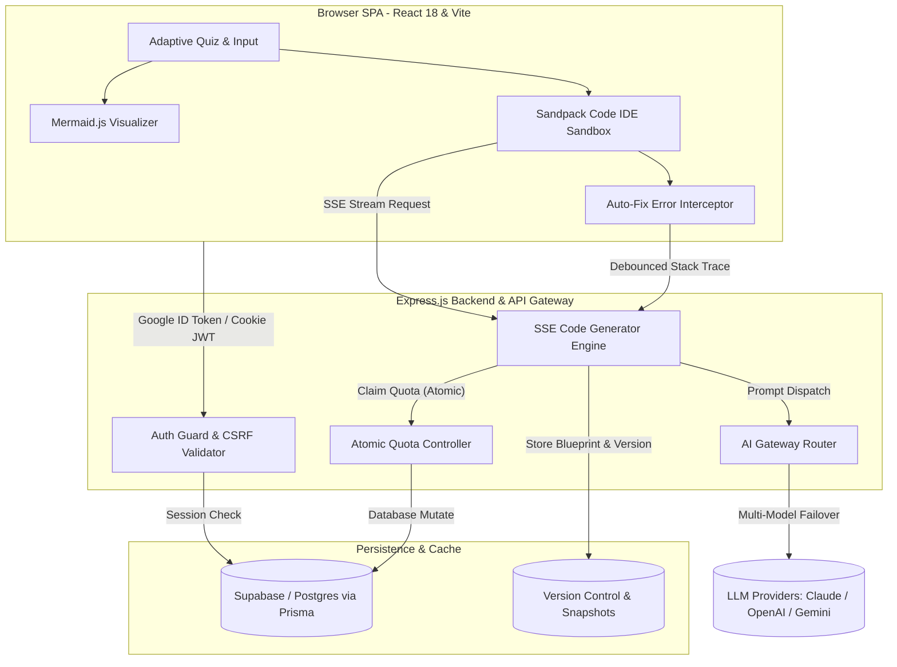

# 🚀 AriseHash — AI Architecture Engine & In-Browser Sandbox Platform

> **Live Demo:** [https://arisexhash.xyz](https://arisexhash.xyz)  
> **Kategori:** Full-Stack Web Application • AI SaaS • Developer Tooling  
> **Peran:** Full-Stack Developer & System Architect  

---

## 📌 Ringkasan Singkat (Short Summary)
*Cocok untuk deskripsi kartu portofolio, postingan LinkedIn, atau ringkasan profil proyek:*

**AriseHash** adalah platform AI Architecture Engine dan interactive web sandbox yang mengotomatisasi perencanaan arsitektur perangkat lunak dari ide mentah menjadi cetak biru teknis lengkap dalam hitungan detik. Platform ini secara dinamis menghasilkan *Product Requirement Documents* (PRD), visualisasi diagram arsitektur interaktif berbasis Mermaid.js, skema database, serta menghasilkan prototipe kode *frontend* modular yang langsung dieksekusi secara *real-time* di dalam browser menggunakan *in-browser runtime sandbox* dengan mekanisme *self-healing error auto-fix loop*.

---

## 💡 Latar Belakang & Masalah (Problem & Solution)

### Permasalahan:
Tahap inisiasi proyek perangkat lunak sering kali memakan waktu berhari-hari hingga berminggu-minggu hanya untuk menyusun PRD, diagram relasi database (ERD), diagram alir sistem, dan *boilerplate* awal. Proses manual ini rentan terhadap ketidakkonsistenan arsitektur dan memperlambat validasi konsep ide produk.

### Solusi yang Dibangun:
AriseHash menyajikan kuis adaptif berbasis domain proyek (Web3, AI, E-Commerce, SaaS), menganalisis parameter teknis (target throughput, tech stack, skema data), lalu memproduksi cetak biru arsitektur komprehensif serta merakit prototipe aplikasi fungsional yang dapat langsung diuji dan dimodifikasi di browser tanpa instalasi lokal.

---

## ⚡ Fitur Utama & Keunggulan Rekayasa (Key Features)

1. **Adaptive Architectural Context Engine**
   - Kuis adaptif dinamis yang meminta detail teknis relevan sesuai kategori sistem yang dibangun untuk menghasilkan PRD yang presisi, kontekstual, dan modular.
2. **Interactive Mermaid.js Architecture Visualizer**
   - Rendering diagram alir sistem, sequence flow, dan skema arsitektur secara visual dan interaktif langsung di frontend.
3. **In-Browser Code Execution (Sandpack Runtime)**
   - Lingkungan sandbox terisolasi di sisi klien (`@codesandbox/sandpack-react`) untuk mengeksekusi kode React 18, Vue, atau Vanilla JS secara langsung dan aman di browser tanpa server kompilasi berat.
4. **Autonomous Self-Healing Code (Auto-Fix Error Loop)**
   - Sistem penanganan galat mandiri yang mengintersepsi pesan error kompilasi/runtime dari Sandpack, membungkus stack trace, dan mengirimkannya kembali ke model AI untuk diperbaiki secara otomatis secara rekursif.
5. **Real-Time Streaming Engine via SSE**
   - Streaming kode multi-file secara real-time menggunakan protokol Server-Sent Events (SSE) dengan parser XML kustom (`<vcFile>`) yang tahan terhadap latensi jaringan.
6. **Multi-Provider AI Gateway & Resilient Failover**
   - Integrasi multi-LLM (Claude 3.5/Opus, OpenAI, Gemini Flash) dengan logika *routing fallback* otomatis jika salah satu penyedia mengalami rate limit atau gangguan layanan.
7. **Bring Your Own Key (BYOK) & Enkripsi AES-256-GCM**
   - Dukungan penggunaan API Key mandiri pengguna dengan penyimpanan terenkripsi tingkat tinggi menggunakan AES-256-GCM.
8. **Stateless Security & Atomic Quota System**
   - Autentikasi berbasis Google OAuth 2.0 dan cookie session `httpOnly` dengan perlindungan Double-Submit CSRF. Pemotongan kuota harian dilakukan secara atomik di level SQL database query (`updateMany`) untuk mencegah race condition dan double-spending.

---

## 🏗 Arsitektur Sistem

---

## 🛠️ Tech Stack Lengkap

| Lapisan | Teknologi | Keterangan / Fungsi |
| :--- | :--- | :--- |
| **Frontend Framework** | **React 18, Vite 5/6** | Single Page Application (SPA) berperforma tinggi dengan *code-splitting* modular |
| **Routing** | **React Router DOM v6** | Client-side routing deklaratif untuk halaman Dashboard, Chat, Studio, dan Admin |
| **UI & Styling** | **Tailwind CSS, Framer Motion, Lucide Icons** | Desain antarmuka modern, dark-mode natif, micro-animations, dan icon pack komprehensif |
| **Sandbox Runtime** | **`@codesandbox/sandpack-react`** | Kompilasi dan eksekusi kode frontend terisolasi langsung di browser |
| **Visualisasi Sistem** | **Mermaid.js** | Visualisasi diagram alur data, ERD, dan arsitektur sistem dinamis |
| **Backend API** | **Node.js, Express.js** | RESTful API, Server-Sent Events (SSE) streaming pipeline, dan middleware keamanan |
| **ORM & Database** | **Prisma 6, PostgreSQL (Supabase)** | Manajemen skema data relasional, pooling koneksi via PgBouncer |
| **AI Protocol & LLM** | **Claude 3.5, Gemini 3.5 Flash, OpenAI API** | Multi-model routing gateway, prompt engineering terstruktur, SSE XML streaming |
| **Autentikasi & Keamanan** | **Google OAuth 2.0, JWT, CSRF Tokens** | Cookie `httpOnly`, proteksi SSRF, sanitasi traversal Sandpack, enkripsi AES-256-GCM |
| **Monitoring & Telemetri** | **Sentry (React & Node.js)** | Pelacakan error real-time dan pemantauan performa aplikasi |
| **Cloud & DevOps** | **Vercel Serverless, Anycast DNS, SSL Let's Encrypt** | Deployment serverless, CI/CD pipeline, custom domain (`arisexhash.xyz`) |

---

## 📝 Contoh Poin Peluru untuk CV / Resume

* Merancang dan mengembangkan **AriseHash**, platform AI Architecture Engine berskala penuh berbasis React 18, Express, Prisma, dan PostgreSQL.
* Mengimplementasikan in-browser IDE sandbox menggunakan `@codesandbox/sandpack-react` lengkap dengan **autonomous error auto-correction loop** untuk mendeteksi dan memperbaiki error kompilasi kode secara mandiri.
* Membangun pipeline streaming multi-file berlatensi rendah menggunakan **Server-Sent Events (SSE)** dan parser XML kustom untuk generasi kode real-time.
* Menerapkan arsitektur keamanan tingkat produksi dengan cookie JWT `httpOnly`, double-submit CSRF guard, enkripsi **AES-256-GCM** untuk penyimpanan BYOK API Key, dan alokasi kuota atomik di level query database.
* Mengonfigurasi arsitektur cloud serverless di Vercel dengan database Supabase PostgreSQL, custom domain Anycast DNS, dan otomatisasi SSL.

website : arisexhash.xyz

